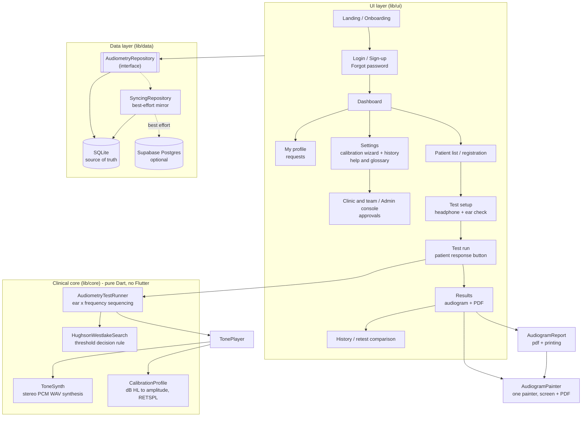

# Auris - Digital Audiometer

A clinic-ready digital audiometer: runs per-ear pure-tone hearing tests, plots a standard audiogram, and generates a printable report - built with and for a practising ENT specialist.


---

## What it does

Auris turns a phone, tablet or laptop with headphones into a pure-tone audiometer. It plays quiet tones into one ear at a time, the patient taps a button whenever they hear one, and the app narrows in on the softest level they can reliably detect at each frequency - the same "down 10 dB, up 5 dB" procedure a clinical audiometer uses.

The result is plotted as a standard audiogram (O for the right ear, X for the left) and turned into a printable PDF with per-frequency thresholds, the pure-tone average, and a classification of hearing loss. Patient records and test history are kept so a follow-up test can be compared against the last one.

**Auris is not a certified medical device.** Read [Clinical limitations & disclaimer](#clinical-limitations--disclaimer) before using it on patients.

> **Testing status (28 October 2026): testing of this version is not complete.** The latest round of fixes (sync, test engine, screens, platform builds) passed static analysis, the pure-Dart engine tests and database checks against Postgres, but the full test suite (`flutter test`) has not yet been run against these changes, and the app has not been fully tested by hand on Android, iOS or macOS. Do not use this version on patients until that is done.

---

## About this repository: from E.S.C.R to Auris

This repository started in October 2023 as **E.S.C.R** (`E.S.C.R_Project_0`), a first attempt at the same idea, and was renamed **Auris** in October 2026. That first commit had a different layout:

| Then (2023) | Now |
|---|---|
| `frontend/`: an early Flutter UI started from a UI template, with that template's placeholder screens and images | `app/`: the Flutter app rebuilt from the ground up as **Auris** (package `dev.priyanshumaniar.auris`) |
| `backend/audiometer.py`, `backend/audio_dart.txt`: a Python tone-generator prototype and notes | `reference/python-prototype/`: kept unchanged as the record of where the tone engine came from; the app now synthesises tones in Dart (`app/lib/core/`) |
| `app_overview.txt`: the original description of the idea | `reference/original-app-overview.txt` |
| No server | `supabase/`: an optional cloud backend (schema, row-level security, Edge Functions) for several clinics |
| No documentation | `docs/`: build, test and cloud setup guides |

When the project became Auris, the repository was started afresh: the old `frontend/` and `backend/` folders and the 2023 presentation were removed, and the history now begins with Auris. What was worth keeping from 2023 is in `reference/`.

---

## Architecture



Two decisions shape everything else:

**The clinical logic has no Flutter in it.** `HughsonWestlakeSearch` is a pure state machine - you hand it responses, it tells you the next level to present. That is what makes the part that actually matters testable exhaustively, without simulating audio hardware or a UI.

**Local storage is the source of truth; the cloud is a replica.** Writes land in SQLite first and the UI reads from there. Sync runs both ways - queued patients, tests and deletes upload, records from other devices download a page at a time - and re-runs by itself whenever connectivity returns. But it is always best-effort: a test in progress must never fail because the clinic's wi-fi dropped, because a half-finished audiogram means calling the patient back.

Merge rules are deliberate. Patients are last-write-wins on `updated_at` - the loser of a conflict is a stale phone number. Test sessions are never overwritten by a pull: a recorded audiogram is evidence, and silently replacing one device's measurements with another's would be indefensible.

---

## Features

**Testing** (following ASHA 2005, *Guidelines for Manual Pure-Tone Threshold Audiometry*, and the BSA 2018 *Recommended Procedure*)
- Diagnostic air-conduction frequencies: 250, 500, 1000, 2000, 3000, 4000, 6000 and 8000 Hz, plus 750 or 1500 Hz added automatically when neighbouring octaves between 500 and 2000 Hz differ by 20 dB or more
- ASHA order: 1, 2, 3, 4, 6, 8 kHz, a **1 kHz retest** in the first ear, then 500 and 250 Hz. A retest more than 5 dB away is flagged, 2 kHz is retested too, and the second ear also gets a 1 kHz retest
- Better ear first, as reported by the patient
- **Familiarisation** at 1 kHz (40 dB HL, rising if needed) before any threshold, checking that responses match the start and end of the tone; repeated once, then the clinician is asked to re-instruct
- Per-ear testing via true stereo channel isolation - a right-ear tone is digitally silent in the left channel
- Modified Hughson-Westlake thresholding: down 10 dB after a response, up 5 dB after a miss; threshold is the lowest level with responses on **at least half of the ascending runs, and at least two** (2 of 2, 2 of 3 or 2 of 4). Only ascending presentations count
- A response at the -10 dB HL floor must be repeated, and is reported as "at or below -10" (≤-10), never as a measured threshold. A search that runs out of presentations reports "not established" (NE) instead of a guess
- Each new frequency starts 30 dB above the nearest threshold already measured in that ear
- Tones of 1 to 2 s and gaps of 1 to 3 s, both varied at random and the gap never shorter than the tone, so a patient cannot respond to a rhythm
- **Press and hold** response: press when the tone starts, let go when it stops. Presses while no tone is playing are counted and reported
- Silent **catch trials** detect a guessing patient; the false-positive rate is reported and flagged
- A break is offered after 20 minutes; the clinician can skip a frequency for a tiring patient, and the report lists it
- Pre-test questions (loud noise in the last 24 hours, tinnitus) and confirmations (hearing aids removed, phones silenced, quiet room), recorded with the test
- 20 ms raised-cosine on/off ramps - an abruptly switched tone produces a click audible below threshold, which would corrupt every reading
- Pause, resume and abandon mid-test; a clinician view toggle hides the presentation level from the patient
- Pre-test left/right channel check: a tone in each ear, and the clinician records where the patient heard it. A test cannot start until every ear being tested has been heard on the correct side, because headphones worn backwards would mirror the whole audiogram
- Headphones or insert earphones, chosen per test and recorded on the report (insert earphones change the masking rule)
- **Output limits respected.** Where the headphones cannot produce 90 dB HL at a frequency under the current calibration, the search stops at the loudest level they can produce, and the report says what "no response" means there. A tone louder than the hardware allows would otherwise play at full volume, quieter than asked, and record a wrong level
- A response at the loudest level is never overruled by a later miss there: a frequency is reported as "no response" only when the patient never responded at that level
- Testing pauses by itself if the app goes into the background (a call, the home button), so no tones play and no misses are scored while nobody is listening. A tone cut short by a pause is presented again afterwards rather than scored
- Each tone is prepared during the gap before it, so it starts the moment the gap ends and the response window lines up with what the patient hears
- A progress line ("sound X of Y") and an estimate of the time left, which adapts to the patient's pace and never hints at when a tone is playing

**Results**
- Standard clinical audiogram: log-frequency X axis, inverted dB HL Y axis, square octave by 20 dB grid (ASHA), shaded normal-hearing band, red O / blue X markers, solid vs dashed lines, no-response arrows
- Per-frequency threshold table distinguishing a measured value, `NR` (no response at maximum output), `≤` (at the quietest level), `NE` (not established) and `-` (not tested)
- **Masking check:** every frequency where the ears differ by 40 dB or more (55 dB with insert earphones, BSA 2018 rule 1) is flagged, because the worse ear's result may be a shadow response
- Pure-tone average across 500/1000/2000 Hz with degree of loss on the Goodman (1965) scale (normal up to 25 dB HL, then mild, moderate, moderately severe, severe, profound)
- Printable A4 PDF with clinic header, patient details (with date of birth, examiner and qualification, reason for the test, equipment and last calibration date), the audiogram, the threshold table, the summary with the classification scheme named, reliability and masking, how the test was done, a calibration-dependent disclaimer and a signature line
- Print, preview and share/send the report
- Retest comparison: two audiograms overlaid, plus a change table highlighting shifts of ≥10 dB. Values "at or below the quietest level" and "not established" are shown as such and are not given a change, and the later test is always compared against the earlier one

**Records**
- Patient CRUD with search by name or clinic reference
- Full test history per patient
- Each test stores a snapshot of the calibration in force at the time, so recalibrating later cannot silently change what a historical audiogram means
- Local-only by default; optional two-way sync to your own Supabase project. A patient registered, a test recorded or a record deleted while offline is remembered and sent once the device is back online. When a device used in local-only mode is switched to cloud sync, its records upload into the clinic of the first clinician or administrator who signs in on it

**User roles**
- **Several clinics in one cloud project.** Every patient, test and account belongs to one clinic, and Postgres row-level security only ever returns the signed-in user's own clinic's records
- Clinic roles - **Administrator**, **Clinician**, **Viewer** - so reception can look up a report without being able to alter a record, plus **Awaiting approval** for new accounts, which see no records at all
- **Super admin** for the people who run Auris: creates clinics and approves accounts for any clinic from an in-app admin console, but sees patients only of an optional home clinic. Granted only with SQL
- Each clinic has a **join code**. Staff enter it at sign-up (or on the waiting screen after Google sign-in) to ask to join; the clinic's admin approves, declines, changes roles or removes access in **Clinic and team**
- Every new account starts as Awaiting approval, on the device and in the cloud. Installing the app and signing up is never enough to read a clinic's records
- Reports carry the signed-in user's own clinic's name, address and phone
- **Profiles and approvals.** Everyone has a profile: name, phone, qualification and registration number (printed with their name on every report), role and what it allows, who approved them and when, and their clinic with its permanent **Clinic ID** (`CLN-0007`), join code and admins. Changes to a profile, an email, a clinic's details, or which clinic someone belongs to are **requests**: a staff member's go to their clinic's admin, an admin's to a super admin. Nothing changes until approved; reviewers see old and new side by side and must give a reason to turn one down. Every request is kept
- An approved email change completes when the user enters a code Supabase sends to the new address. Staff can move to another clinic (the new clinic's admin decides), leave a clinic at once, or ask a super admin to delete their account; their patients and tests stay with the clinic
- Optional email alerts to approvers and requesters through an Edge Function, which anyone can switch off for themselves
- One device, many accounts: the records cached on a device are tagged with their clinic, and each account sees only its own clinic's records
- Enforced in three places: the UI hides what a role cannot do, the repository layer throws before any write is attempted, and Postgres row-level security rejects it server-side. Only the last of those is a real security boundary; the other two exist so failures are obvious in development
- Local-only mode (no cloud): a new device opens on sign-up, the first account on it is automatically its administrator, and roles are managed in **Settings → Team**, where an administrator can also set a new password for someone who has forgotten theirs. The profile works there too, with changes applied at once since there is nobody else to approve them
- An unknown or missing role resolves to Awaiting approval (no access) - access control fails closed

**Accounts (cloud mode)**
- Email and password (entered twice at sign-up), or **Continue with Google** on Android, iOS and macOS. Google sign-in opens in the browser and hands back to the app through the `dev.priyanshumaniar.auris://` link; a join code typed on the Sign Up screen is sent as a request to join once the account exists
- **Forgot password** inside the app: Supabase emails a one-time code, the user types it in and sets a new password. A code instead of the usual link, because a link needs a web page to land on and Auris is a desktop and mobile app
- Every password field has a show / hide (eye) button
- A Google account starts as Awaiting approval like any other later account; an administrator approves it. Setup steps: [SUPABASE_SETUP.md](docs/SUPABASE_SETUP.md)

**Calibration**
- Four-step guided wizard, written for someone who has never calibrated anything: what it does, pick a method, measure, done
- **Two methods.** With a sound level meter (accurate) or with a **biological check** against a normal-hearing listener, for the many clinics that do not own a meter
- The method used is stored per test and printed on the report, so a biological check is never mistaken for a measured one
- RETSPL correction per ISO 389-1 (TDH-39), so equal dB HL at different frequencies means equal hearing level rather than equal digital amplitude
- Uncalibrated devices are allowed to test, but every screen and the PDF say so plainly
- **Per ear.** Calibrate both ears (default), or the left or right only. Each side of the headphones gets its own correction, because two earpieces are rarely equally loud and any difference would otherwise appear on the audiogram as a difference between the patient's ears
- After a single-ear calibration the administrator chooses: copy it to the other ear (marked "copied", never "measured") or keep the other ear exactly as it was
- When both ears are measured and differ by more than 10 dB, Auris warns before saving, since that usually means a damaged, blocked or badly seated earpiece
- Calibrating both ears on a person requires confirming the listener has no known hearing difference between their ears; otherwise the wizard offers a single-ear calibration instead
- Calibration with a human listener carries a standing warning in the app and on every report that it is not a standard calibration
- **Calibration history.** Every calibration and reset is recorded on the device (who, when, headphones, method, what happened to each ear) under Settings → Calibration history, each with a printable PDF record
- **Reset calibration** in Settings returns the device to uncalibrated (screening only), and the reset is recorded in the history too
- The listener check stops if the app goes into the background, and never asks for a level the headphones cannot produce

**Help**
- A three-page introduction on first launch
- **Help & glossary** (Settings): every term the app uses, from dB HL and masking to roles, join codes and approvals, searchable

---

## Run locally

Requires Flutter 3.47 or newer (Dart 3.13 or newer), which the locked package versions need.

**1. Clone and enter the app directory**
```bash
git clone https://github.com/priyanshumaniar/Auris.git && cd Auris/app
```

**2. Create your `.env`** - required, even if you leave it empty (Flutter bundles it as an asset)
```bash
cp .env.example .env
```

**3. Install dependencies**
```bash
flutter pub get
```

**4. Run it**
```bash
flutter run
```

**5. Run the tests**
```bash
flutter test
```

**6. (Optional) Enable cloud sync** - follow [docs/SUPABASE_SETUP.md](docs/SUPABASE_SETUP.md). Without it, Auris runs entirely offline.

> Runs on **Android, iOS and macOS**, and on **Windows and Linux** desktops through `sqflite_common_ffi` (without Google sign-in there). **Flutter web is not supported** - sqflite has no web implementation.

Release builds for Android, macOS and iOS (including Play Store signing), and the hardware checks to run before using it on a patient, are in **[docs/BUILD_AND_TEST.md](docs/BUILD_AND_TEST.md)**.

---

## Environment variables

All live in `app/.env`. Copy `app/.env.example` and fill in what you need.

| Variable | Purpose | Required? |
|---|---|---|
| `SUPABASE_URL` | Supabase project URL. Enables cloud sync when set together with the anon key. | No - local-only if blank |
| `SUPABASE_ANON_KEY` | Supabase anon/publishable key. Safe to ship in a client; row-level security decides access. **Never use the service_role key.** | No - local-only if blank |
| `CLINIC_NAME` | Clinic name printed in the PDF report header in local-only mode. In cloud mode reports use the signed-in user's own clinic, and this is only a fallback for an account with no clinic. | No - defaults to "Auris Hearing Clinic" |
| `CLINIC_ADDRESS` | Address line in the report header (same rule). | No |
| `CLINIC_PHONE` | Phone line in the report header (same rule). | No |

---

## Storage footprint

Measured, not estimated - a script built a real database through the real repository and weighed the SQLite pages:

| Records | On disk |
|---|---|
| One completed test (12 thresholds + session + calibration snapshot) | **1.5 KB** |
| One patient with 10 tests | 14.8 KB |
| 1,000 tests | 1.4 MB |
| 10,000 tests | 14.5 MB |
| 100,000 tests | 145 MB |

A clinic running 20 tests a day, six days a week, accumulates about **9 MB a year**. Records are kept on the device permanently and are not deleted after upload: local storage is the source of truth, and purging it would break offline history, retest comparison and report regeneration - for a saving of a few megabytes a year.

The transient cost is larger and is bounded deliberately. Each second of stereo float32 tone is ~345 KB, and a stimulus is keyed by frequency, ear, *amplitude* and length, so a full test touches hundreds of distinct tones - tens of megabytes if cached without limit. [`ToneCache`](app/lib/core/audio/tone_cache.dart) caps that at 24 files with least-recently-used eviction, deletes its files on shutdown, and sweeps anything left behind by a crashed run on the next start.

What actually consumes disk during development is `build/` - hundreds of megabytes per platform. `flutter clean` reclaims it.

---

## Privacy

Patient records are health data, and Auris treats them that way:

- **Local first.** Everything is written to an on-device SQLite database. With no `.env` configured, no patient data leaves the device at all.
- **Your infrastructure only.** If you enable sync, records go to *your* Supabase project. There is no Auris server, no vendor backend, and no telemetry.
- **No analytics, no third-party SDKs, no crash reporting.** Nothing phones home.
- **Row-level security.** Every synced row belongs to one clinic, and Postgres only ever returns the signed-in user's own clinic's rows (`supabase/schema.sql`). Deleting an account keeps its patients and tests with the clinic.
- **Nothing in the repo.** No patient data, no database files, and no exports are committed - `.gitignore` blocks `*.db`, `*.sqlite`, and export paths.

Enabling cloud sync makes you the data controller for that Supabase project. Check what your jurisdiction requires (India's DPDP Act 2023, GDPR Art. 9, HIPAA). Auris does not make a deployment compliant on its own.

---

## Clinical limitations & disclaimer

**Auris is not a certified medical device.** It is not cleared or approved by any regulatory body, and it does not replace assessment by a qualified audiologist or ENT specialist. It does not produce a diagnosis.

**Calibrated headphones are required for the numbers to mean anything.** The app controls a digital amplitude; what reaches the eardrum depends on the OS volume, the DAC, the amplifier and the headphones. Until you calibrate against a sound level meter, the *shape* of an audiogram is meaningful but its absolute dB HL values are not. Uncalibrated results are marked screening-only on screen and on the PDF.

**Air conduction only, unmasked.** Auris cannot distinguish conductive from sensorineural loss - that needs bone conduction, which needs a bone oscillator. It also does no masking, so a large asymmetry between ears can produce a shadow curve where the better ear responds for the worse one.

Also not implemented today:

- **Masking is flagged, not done.** Where the ears differ enough to need masking, the report says so; confirm those frequencies with a masked test.
- **Some numbers are Auris's own choices, not from ASHA or BSA:** the 1.5 s response window, the 25% cut-off for "unreliable", and the release timing used in familiarisation. Neither guideline gives a number for these.
- **The release is checked during familiarisation only.** During the test a press is the response; letting go is not scored.
- **No speech audiometry, tympanometry or OAE.**
- **Maximum output is capped at 90 dB HL**, not the 120 dB HL of a clinical audiometer, and lower at frequencies where the headphones cannot reach 90 under the current calibration (the report lists those). This is deliberate: on uncalibrated consumer hardware a mis-set volume at very high nominal levels risks real hearing damage. Profound losses will read as "no response".
- **Calibration uses one frequency per ear.** Each ear is calibrated at 1 kHz and that correction is applied across all frequencies; frequency-by-frequency calibration is not done in the app.
- **Calibration history stays on the device.** Like the calibration itself, it belongs to the device and headphone pair and is not synced to the cloud.
- **Ambient noise is not measured.** A quiet room is assumed and cannot be verified; background noise masks quiet tones and inflates thresholds.
- **Super admins and home clinics are set with SQL, not in the app,** on purpose; everything else about clinics and accounts is managed in the app. [SUPABASE_SETUP.md](docs/SUPABASE_SETUP.md) gives the statements.
- **Cloud sync has no automated round-trip test.** It has been used against a live Supabase project during development, the merge rules and the local sync bookkeeping are unit-tested, and the database rules were checked against Postgres, but no test drives a real server. Deletes also do not reach other devices' copies: a device that already downloaded a record keeps it after another device deletes it.
- **No client-side encryption.** Data is encrypted in transit and at rest by Supabase, but a Supabase administrator could read patient records.
- **Password hashing is PBKDF2-HMAC-SHA256 (50k iterations) in pure Dart** for local accounts. Argon2 via a native binding would be stronger.
- **Web compiles but will not run.** `flutter build web` succeeds, but sqflite has no web backend, so the app stops on a startup message instead of loading. Supporting web would mean adding `sqflite_common_ffi_web`. Use Android, iOS, Windows, macOS or Linux.
- **Audio output has only been checked by ear on macOS** (built-in speakers and wired earphones). Tone synthesis is unit-tested at the byte level (waveform, envelope, channel isolation, WAV headers), but other platforms have not been listened to. Tones are generated as 32-bit float WAV because 16-bit PCM quantises near-threshold levels to silence; not every platform audio backend decodes float WAV, so `TonePlayer` falls back to 16-bit automatically if playback fails. **Verify audibility and left/right routing on your target device before any clinical use** - the in-app headphone check on the test setup screen exists for exactly this.
- **Tone latency is not characterised.** Playback goes through the platform audio stack; the tone duration is correct but onset latency has not been measured on each platform.

---

## Testing

282 tests. The weight is deliberately on the clinical logic:

| Suite | What it covers |
|---|---|
| `hughson_westlake_test.dart` | Convergence to a simulated patient's true threshold at every 5 dB step from -10 to 90 dB HL; that descending responses never count; that one ascending response is not enough; that every reported threshold has responses on at least half of its ascending runs; the floor rule; "not established" when out of presentations; no-response handling, including that a response at the maximum is never overruled; termination under random responding |
| `tone_synth_test.dart` | WAV header correctness (float32 and int16), per-ear channel isolation, amplitude accuracy, ramp monotonicity, and that float32 preserves near-threshold levels 16-bit quantises to silence |
| `classification_test.dart` | Degree-of-loss boundaries, PTA with no-response frequencies, RETSPL interpolation, dB→amplitude monotonicity, clipping detection |
| `test_runner_test.dart` | Ear/frequency sequencing, per-ear stimulus routing, catch-trial delivery, abort, progress, varied tone lengths, starting levels, the 1 kHz retest and what a failed one triggers, interoctave frequencies, presses between tones, familiarisation and re-instruction, skipping (and when a skip is ignored), breaks, pausing mid-tone, and output limits |
| `clinic_model_test.dart` | Reading clinics and accounts from the cloud, Clinic IDs, profile fields and report credentials, unknown roles reading as no access, and the cached profile and clinic |
| `change_request_test.dart` | Reading requests, old and new values side by side, the clinic asked for, deleted accounts, every kind and status, and which email change waits for its code |
| `test_protocol_test.dart` | The stored test record and its round trips, floor and not-established results in plots and averages, the masking check for both transducer types, reliability concerns, the interoctave rule, frequency labels |
| `repository_test.dart` | Real SQLite: round-trips, cascade deletes, that editing a patient keeps their tests, search, sync queue, foreign-key enforcement, the stored test record, records scoped to one clinic on a shared device, sync bookkeeping (patients waiting to upload, deletes made offline, batched lookups), and the schema migrations |
| `audiogram_widget_test.dart` | Chart and table rendering, NR vs untested cells, headless rasterisation for the PDF |
| `pdf_report_test.dart` | Valid PDF output across edge cases (one ear, all no-response, empty), metadata, embedded Unicode font |
| `roles_test.dart` | Every role's capabilities, that a new account awaiting approval sees nothing, that unknown roles fail closed, that the repository blocks forbidden writes, first-account-is-admin, last-admin protection, that passwords never appear in the database, and the local profile: direct changes, password change with the current password, cloud-only requests refused |
| `per_ear_calibration_test.dart` | Old calibrations still apply to both ears unchanged; a measured ear changes only that ear; corrections stack; copy vs keep; the profile reports its weakest ear; left/right imbalance; round trips; calibration history order and contents; the calibration record PDF |
| `auris_input_field_test.dart` | The password eye button: starts hidden, reveals and re-hides, keeps what was typed, and never appears on ordinary fields |
| `sync_test.dart` | Merge rules: last-write-wins on patients, never overwriting a recorded session, tie-breaking, sync reporting (including refused and already-running syncs), and reading rows exactly as Postgres returns them |
| `progress_estimator_test.dart` | The time-left estimate and its adaptation to the patient's pace, and calibration conversions it depends on |
| `tone_cache_test.dart` | The tone cache's size bound, least-recently-used eviction, clean-up on shutdown and the sweep of files left by a crashed run |

```bash
cd app && flutter test
```

---

## Project layout

```
app/                       Flutter application
  lib/core/audiometry/     Clinical logic - pure Dart, no Flutter imports
  lib/core/audio/          Tone playback
  lib/data/                Models, SQLite, repositories, auth, roles, sync
  lib/report/              PDF generation
  lib/ui/                  Screens, widgets, theme
  test/                    282 tests
  android/ ios/ macos/     Platform projects (also windows/, linux/, web/)
docs/BUILD_AND_TEST.md     How to run, build releases and verify the audio path
docs/SUPABASE_SETUP.md     Step-by-step cloud sync setup
supabase/schema.sql        Postgres schema + role-aware row-level security
supabase/migration_*.sql   One-off updates for projects set up earlier
supabase/checks/           What one account can see, for checking access
supabase/functions/        Edge Functions: delete-account, notify (email alerts)
reference/                 Original Python tone-generator prototype and spec,
                           superseded by the Dart engine but kept as provenance
```

---

## Screenshots

_Screenshots coming soon._

---

<!--
  TODO (Priyanshu): drop the ENT specialist's own words in here, then delete
  this comment and uncomment the section below. Do not paraphrase or invent -
  use their actual sentences, with their permission to be quoted publicly.

## From the clinician

> "…"
>
> - <Name>, <Qualification>, <Clinic>
-->

## License

MIT - see [LICENSE](LICENSE). © 2026 Priyanshu Ashish Maniar.

Bundled Roboto font is Apache-2.0 (`app/assets/fonts/Roboto-LICENSE.txt`).

---

## Author

**Priyanshu Ashish Maniar** - [github.com/priyanshumaniar](https://github.com/priyanshumaniar)

Built with a practising ENT specialist as the domain stakeholder.
